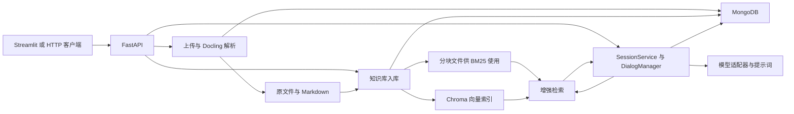

# RAG Agent v2 架构与源码分析

本文基于源码和锁定依赖，描述当前实现。启动、配置和 HTTP 接口见[使用指南](README.md)。

## 模块与数据流

| 模块 | 职责与入口 |
| --- | --- |
| HTTP 和演示界面 | [FastAPI 入口](../src/api/main.py)负责启动时初始化 MongoDB ODM、注册提示词及加载文档标题缓存。[依赖层](../src/api/dependencies.py)惰性创建会话服务和管理器。[Streamlit](../streamlit_demo.py)通过 HTTP 调用后端。 |
| 文档处理 | [文档服务](../src/document/document_service.py)负责上传和解析任务，[解析器](../src/document/parse.py)封装 Docling 和文档元数据抽取。 |
| 知识库与检索 | [知识库服务](../src/rag/knowledge_base/knowledge_base_service.py)管理知识库和文档关联，[入库函数](../src/rag/ingest/ingest.py)处理分块和索引，[增强流程](../src/rag/retrieve_pipeline/enhanced_pipeline/EnhancedPipeline.py)处理查询和上下文。 |
| 会话与模型 | [SessionService](../src/session/SessionService.py)协调消息和记忆，[DialogManager](../src/session/dialog/DialogManager.py)准备模型输入、转发增量文本并保存消息。[模型工厂](../src/llm/factory.py)提供聊天适配器。 |

## 数据存储

| 数据 | 默认位置和标识 |
| --- | --- |
| 文档记录 `DocumentRecord` | MongoDB `document_record`。存原文件名、MD5、原文件路径、Markdown 路径、标题、摘要、关键词、目录和语言。 |
| 知识库 `KnowledgeBase` | MongoDB `knowledge_base`。保存知识库名及分块大小、重叠、分块方式和检索器类型。 |
| 关联记录 `CollectionRecord` | MongoDB `collection_record`。每条记录连接一个知识库和一份文档，并保存该次入库的分块路径及数量。文档可以关联到多个知识库。 |
| 原文件与 Markdown | 分别位于 `data/stored_files/` 和 `data/markdown_files/`。同一文档使用同一随机文件名主干。 |
| 文档分块与向量 | 分块写入 `data/chunked_files/<关联记录ID>.pkl`。向量或混合知识库使用同名 Chroma 集合，默认持久化到 `data/chroma_db/`。 |
| 会话 `Session` | MongoDB `session`。保存用户 ID、系统提示、消息数组、会话元数据、短期记忆和摘要计数。 |
| 用户记忆 | `LongTermMemory` 注册在 MongoDB `long_term_memory`。会话历史分块写入 `data/chunked_memory/<用户ID>.pkl`，默认还写入以用户 ID 命名的 Chroma 集合。 |

字段定义见 [DocumentRecord](../src/document/odm/DocumentRecord.py)、[KnowledgeBase](../src/rag/knowledge_base/odm/KnowledgeBase.py)、[CollectionRecord](../src/rag/knowledge_base/odm/CollectionRecord.py)、[Session](../src/session/odm/Session.py)和 [LongTermMemory](../src/session/memory/LongTermMemory.py)。

## 从上传到索引

1. **接收上传。** 文件整读进内存后检查大小，默认上限 10 MiB。按内容 MD5 查询重复记录，通过后写入原文件并创建 `DocumentRecord`。上传响应发出后，FastAPI 在同一应用进程中执行后台解析。见[上传及解析服务](../src/document/document_service.py#L41)。
2. **解析 Markdown。** 后缀检查允许小写 `.pdf`、`.docx`、`.doc`、`.txt`、`.md`，实际转换由 Docling 决定。解析器将转换放在线程中执行，并行抽取标题、摘要、关键词和目录，同时根据文本判断中英文。文档列表根据 `markdown_path` 是否存在于记录中生成 `metadata.is_prased`。处理中和解析失败均可能显示为 `false`，当前 API 无独立状态或重试接口。见[解析入口](../src/document/parse.py#L78)。
3. **关联知识库。** 添加文件时读取该知识库保存的分块和检索设置，先插入 `CollectionRecord`，再切分并建索引，最后保存分块路径和数量。API 建库默认 `recursive / 500 / 50 / hybrid`，Streamlit 表单默认 `hierarchical / 300 / 50 / hybrid`。关联使用知识库记录中的值，调整 `pyproject.toml` 不会修改既有记录。见[建库请求模型](../src/api/models.py#L96)和[关联服务](../src/rag/knowledge_base/knowledge_base_service.py#L80)。
4. **生成分块和索引。** 层级分块识别 Markdown 的一至三级标题，节内按字符长度切分，当前忽略 `chunk_overlap`。文档块使用从零开始的字符串 ID，携带章节标题、文档标题、关联 ID 和总块数。所有策略都会保存本地 pickle，`vector` 和 `hybrid` 还会向 Chroma 写入向量，每批最多 10 块。BM25 首次检索时从 pickle 构建内存索引。见[分块入口](../src/rag/ingest/text_splitter/get_chunks.py)、[文档入库](../src/rag/ingest/ingest.py#L20)和 [BM25 检索器](../src/rag/retriever/bm25_retriever/BM25Retriever.py)。

## 从问题到回答

1. **查询改写与路由。** 对携带知识库 ID 的消息，`EnhancedPipeline` 读取知识库关联。默认同时启用查询改写和路由。改写结果提供 `EN`、`ZH` 查询，路由模型按文档标题及关键词输出每份文档的召回数量。
2. **召回。** `vector` 使用 Chroma，`sparse` 使用 BM25，`hybrid` 将两路候选直接拼接。关闭路由时，在检索器之间平分候选额度。BM25 当前沿用空白分词，对无空格中文的命中效果有局限。
3. **重排与扩展。** 默认每 5 个候选交给 LLM 打分，再按分数降序排列。随后按关联 ID 和分块 ID，从 Chroma 取命中块及前后各 3 块，合并重复 ID 并组织成文本。
4. **模型回答。** `DialogManager` 将检索上下文填入 `RAG_answer` 模板。未指定知识库时使用 `plain_chat`。HTTP 响应逐块发送正文。模型流正常结束后，原始问题和聚合后的回答才依次写入 MongoDB。知识上下文保存在用户消息的 `metadata.retrieved_context` 中，流响应只包含文本。

实现见[增强检索](../src/rag/retrieve_pipeline/enhanced_pipeline/EnhancedPipeline.py#L49)、[检索器选择](../src/rag/retrieve_pipeline/retrieve.py#L27)、[重排](../src/rag/retrieve_pipeline/enhanced_pipeline/rerank.py)、[上下文扩展](../src/rag/retrieve_pipeline/enhanced_pipeline/context_retrieve.py)和[对话生成](../src/session/dialog/DialogManager.py#L76)。

## 会话记忆与提示词

- **短期摘要。** 会话服务在新一轮回复写入前，依据消息数和上次摘要计数判断是否触发。摘要的目标是压缩旧消息并将结果保存在 `Session.memory`。当前正常轮次难以触发，详见下节。见[短期摘要实现](../src/session/memory/MemoryManager.py#L28)。
- **长期摘要与历史召回。** 退出非空会话会并发生成长期摘要、将历史入库和生成会话标题。聊天开始时，`SimplePipeline` 按用户 ID 召回历史片段并拼接。当前摘要只写入会话私有字段，长期摘要和召回内容均未有效注入系统提示。见[退出会话](../src/session/SessionService.py#L45)、[记忆管理](../src/session/memory/MemoryManager.py#L61)和[系统消息组装](../src/session/odm/Session.py#L95)。
- **提示词注册。** 应用启动时导入 `src/prompt` 各子包的 `register.py`，由对应的 `prompts.toml` 注册模板、输入映射、模型参数和输出解析器。模板位于各子包的 `prompt_template/`。普通调用渲染模板并应用输出解析器，流式调用将渲染结果作为本轮用户消息附加到模型输入。见[注册入口](../src/prompt/register.py)、[配置解析](../src/prompt/auto_register.py)和[模型调用](../src/prompt/llm_call.py)。

## 已知问题

| 范围 | 当前行为及影响 |
| --- | --- |
| 建库默认分块 | API 默认的 `recursive` 会把拼错的 `speparators` 传给 LangChain，添加文档时触发 `TypeError`。建库时可显式选择 `hierarchical`。创建请求携带非空 `record_ids` 时也会失败。见[分块适配器](../src/rag/ingest/text_splitter/LangchainTextSplitter.py#L7)和[建库服务](../src/rag/knowledge_base/knowledge_base_service.py#L16)。 |
| 路由与检索额度 | 模型返回项按顺序对应关联记录，返回顺序变化、漏项或同名文档会影响路由。召回循环将双语查询替换为首个选中集合的语言版本，后续集合沿用该版本。`[tool.rag].top_k` 未接入增强流程，关闭路由时使用硬编码 10，重排也未按 `top_k` 截断。见[路由实现](../src/rag/retrieve_pipeline/enhanced_pipeline/EnhancedPipeline.py#L111)、[向量召回](../src/rag/retriever/chroma_retriever/ChromaRetriever.py#L86)、[稀疏召回](../src/rag/retriever/bm25_retriever/BM25Retriever.py#L67)和[重排实现](../src/rag/retrieve_pipeline/enhanced_pipeline/rerank.py#L51)。 |
| 检索开关组合 | 相邻块固定从 Chroma 读取，纯 `sparse` 入库没有向量内容可供扩展。关闭路由后，向量全局 Top-K 丢失分块 ID，保留扩展开关时可能在转换 ID 的环节失败。见[上下文扩展](../src/rag/retrieve_pipeline/enhanced_pipeline/context_retrieve.py#L32)和[向量 Top-K](../src/rag/retriever/chroma_retriever/ChromaRetriever.py#L140)。 |
| 索引一致性 | 入库先插入关联，再写磁盘和 Chroma，失败可能留下部分数据。批量添加按顺序提交，关联复合索引也未声明唯一，重试可能产生重复关联。见[关联服务](../src/rag/knowledge_base/knowledge_base_service.py#L80)和[关联索引](../src/rag/knowledge_base/odm/CollectionRecord.py#L23)。 |
| 文档与知识库删除 | 知识库删除路由直接删除知识库记录，关联记录和索引可能残留。删除文档会删除关联记录及文档记录，本地原文件和 Markdown 没有清理步骤。解绑需要关联记录 ID，调用缺少 `await`，也未核对归属。关联删除钩子将 `.pkl` 路径交给目录删除函数。见[知识库删除路由](../src/api/routers/knowledge_base.py#L124)、[解绑服务](../src/rag/knowledge_base/knowledge_base_service.py#L59)、[文档删除](../src/document/document_service.py#L24)和[清理钩子](../src/rag/knowledge_base/odm/CollectionRecord.py#L37)。 |
| 会话接口 | `/chat` 未实现。`/sessions/{id}/messages` 的倒序切片可能报错或返回空列表，`/session-list` 忽略分页参数。Streamlit 的“删除会话”按钮调用退出接口，有消息的会话仍会保留。真正的删除接口将会话 ID 当作用户记忆集合名，清理失败会中断数据库删除。见[会话服务](../src/session/SessionService.py)、[历史切片](../src/session/odm/Session.py#L35)和[演示界面](../streamlit_demo.py#L565)。 |
| 记忆持久化与注入 | 短期摘要的等值触发条件与初始计数 `-1` 在常规完整轮次下不匹配，摘要的纯文本解析结果也与列表字段声明不一致。长期摘要未写回 `LongTermMemory`，系统提示检查的属性名与两个私有记忆字段不一致。按用户覆盖的 pickle 和从零编号的向量块还会造成跨会话冲突。`min_similarity_score` 未参与召回。见[记忆管理](../src/session/memory/MemoryManager.py)、[系统消息](../src/session/odm/Session.py#L95)和[记忆检索](../src/rag/retrieve_pipeline/retrieve.py#L81)。 |
| 数据库驱动兼容性 | 锁定的 Beanie 2.0.1 以 PyMongo 异步数据库为接口，应用仍传入 Motor 客户端。两者的部分方法签名和等待方式有差异。当前连接及 CRUD 的实际行为需要用 MongoDB 联调确认。见[应用启动](../src/api/main.py#L20)和 [Beanie 2.0 迁移说明](https://github.com/BeanieODM/beanie/releases/tag/2.0.0#breaking)。 |
| 接口访问边界 | 当前没有身份认证或资源归属校验，`user_id` 由客户端传入，CORS 允许任意来源。Streamlit 的固定用户 ID 会在同一后端共享会话与记忆数据。见[应用配置](../src/api/main.py#L67)和[会话路由](../src/api/routers/chat.py)。 |

## 优化顺序与验收

以下顺序按本地单用户演示安排。先让默认路径可重复验证，再修复数据一致性和召回正确性。性能改动以测量结果为依据。

| 顺序 | 改动 | 验收标准 |
| --- | --- | --- |
| P0 默认流程和回归基线 | 修正递归分块参数，校验建库请求的分块方式和数值范围。让模型适配器按需初始化，使会话 CRUD 和接口检查可在无模型密钥时运行。将回归测试纳入版本管理，用临时 MongoDB、独立 Chroma 目录和可预测的模型替身覆盖主链路。 | 默认参数建库后可上传、解析并关联文档。对已知答案发起流式问答，正常结束后恰好保存一条用户消息和一条回复。缺少密钥时，在实际使用对应模型的入口给出清晰错误。 |
| P1 入库与删除一致性 | 给文档解析和索引关联记录明确状态，检索只读已完成的索引。清理已有重复关联后，以知识库 ID 和文档 ID 建立唯一约束。统一删除和解绑路径，校验归属，并为磁盘、MongoDB、Chroma 的部分失败保留可重试状态。 | 并发添加同一文档只产生一条关联。模拟向量批次写入失败，查询看不到半成品，重试能恢复。重复删除后各处无残留，共享到其他知识库的文档仍可用。 |
| P1 检索正确性 | 用稳定的关联 ID 匹配和校验路由输出，逐集合选择查询语言。保留向量召回的分块 ID，按关联 ID 和分块 ID 去重，纯稀疏检索保留命中块。关闭扩展时按关联分组，保留同一文档的多个命中片段。 | 双语文档分别收到对应语言的查询。不同文档中编号相同的片段均可保留。路由返回乱序、向量关闭路由、纯 BM25 和关闭扩展四种情况下都有可预期的上下文。 |
| P1 会话可靠性 | 用一次原子更新写入完整问答轮次并更新消息计数，为重试定义轮次标识。修复分页和删除入口。记忆集合不存在或为空时跳过召回，记忆服务异常时继续基础聊天。Streamlit 改用 UTF-8 增量解码。 | 两个并发请求各保存一轮，重复请求只保存一次，模型中断后不会留下半轮。首次普通聊天跳过向量调用，记忆服务超时仍能回答，中文字符拆分到多个响应块后仍能显示。 |
| P2 召回预算与性能 | 先记录路由、改写、Chroma、BM25、重排及首段回答的耗时、模型调用数和上下文长度。再接入召回总量、重排候选上限和上下文预算。确认瓶颈后，考虑合并重复数据库读取、复用同语言查询向量，并将同步检索移出请求事件循环。并行化前先移除 BM25 实例上可变的请求级 `k`。 | 固定中英问题和文档集，对比召回命中率、空召回率、首段回答 p50/p95 延迟、调用数和上下文长度。单文档、多文档和并发场景分别记录。 |
| P2 记忆功能 | 会话持久化稳定后，再补齐摘要触发、类型、持久化及系统提示注入。给记忆分块分配稳定的会话内标识，并记录入库进度。 | 跨会话可以召回指定历史，重复退出不会重复入库。删除一条会话后只移除其记忆，且同用户其他会话的历史仍可召回。 |

启动基线应覆盖 MongoDB 连接、指定库名、CRUD 和关闭流程。统一库名的配置入口，并将 MongoDB 客户端调整到锁定 Beanie 所用的 PyMongo 异步接口后重跑上述流程。见[应用启动](../src/api/main.py#L20)和[连接辅助函数](../src/database/mongo/mongo.py#L9)。

多人共享或对外提供服务时，身份认证、会话与文档的访问控制、记忆与知识库的存储隔离属于上线前的 P0。当前客户端传入的 `user_id` 会参与记忆文件路径和 Chroma 集合命名，宜改为由服务端根据已认证身份生成的标识。用两个用户互相尝试读、写、删和召回对方资源，并检查异常标识无法跳出存储目录。见[会话路由](../src/api/routers/chat.py)和[记忆入库](../src/session/memory/MemoryManager.py#L84)。

本轮隔离检查复现了两个召回缺陷。BM25 的去重函数读取 `record_id`，实际片段使用 `collection_id`，因此跨文档的同编号片段被误合并。双语查询在循环中被替换成首个集合的语言，后续集合收到相同查询。当前尚未测量真实流量下的延迟和召回质量。见[去重函数](../src/rag/utils.py#L4)、[分块元数据](../src/rag/ingest/ingest.py#L49)和 [BM25 检索](../src/rag/retriever/bm25_retriever/BM25Retriever.py#L69)。

## 修改入口

- 新增提示词时，在相应子包添加 Markdown 模板和 `prompts.toml` 配置。复杂输入可以参照 `query_route` 注册自定义构造器。见[路由提示词注册](../src/prompt/rag/register.py)。
- 新增聊天模型时，按 `BaseChatAdapter` 的契约实现调用和流式能力，并接入 `get_llm`。新增向量模型时，还需要让 `SyncEmbeddingFunction` 使用新适配器，当前路径默认百炼且请求模型写死。见[聊天适配器](../src/llm/adapter/BaseChatAdapter.py)、[聊天工厂](../src/llm/factory.py)和[向量适配器](../src/embedding/adapter/BailianEmbeddingAdapter.py)。
- 新增分块方式时，从 `get_chunks` 的分派入口接入，检查块 ID 和元数据能被召回及上下文扩展消费。替换检索流程时，知识库问答和历史记忆分别从依赖层注入，当前问答使用 `EnhancedPipeline`，记忆使用 `SimplePipeline`。见[分块入口](../src/rag/ingest/text_splitter/get_chunks.py)、[检索协议](../src/rag/retrieve_pipeline/RetrievePipelineProtocol.py)和[依赖层](../src/api/dependencies.py)。

## 核对范围

已通过 78 个 Python 源文件的语法解析和依赖锁文件离线校验。用本地缓存的锁定依赖导入应用并注册了 11 个提示词。在跳过启动生命周期的进程内检查中，`/health`、`/openapi.json`、`/docs` 均返回 200。另对默认递归分块、向量 Top-K、重排、消息切片和系统记忆字段进行了隔离检查。

当前仓库未跟踪自动化测试。以上检查未连接 MongoDB 或调用模型服务，上传、索引、流式生成和记忆的完整链路仍待联调。复现步骤见[文档问答流程](README.md#文档问答流程)。
