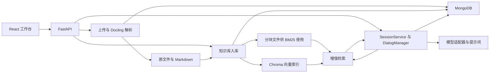

# RAG Agent v2 架构与源码分析

本文基于源码和锁定依赖，描述当前实现。启动、配置和 HTTP 接口见[使用指南](README.md)。

## 模块与数据流

| 模块 | 职责与入口 |
| --- | --- |
| 前端和 HTTP 接口 | [React 工作台](../frontend/src/App.tsx)通过[共用 API 客户端](../frontend/src/api/index.ts)调用 FastAPI。[FastAPI 入口](../backend/src/api/main.py)启动时初始化 MongoDB ODM、注册提示词及加载文档标题缓存，[依赖层](../backend/src/api/dependencies.py)惰性创建会话服务和管理器。 |
| 文档处理 | [文档服务](../backend/src/document/document_service.py)负责上传和解析任务，[解析器](../backend/src/document/parse.py)封装 Docling 和文档元数据抽取。 |
| 知识库与检索 | [知识库服务](../backend/src/rag/knowledge_base/knowledge_base_service.py)管理知识库和文档关联，[入库函数](../backend/src/rag/ingest/ingest.py)处理分块和索引，[增强流程](../backend/src/rag/retrieve_pipeline/enhanced_pipeline/EnhancedPipeline.py)处理查询和上下文。 |
| 会话与模型 | [SessionService](../backend/src/session/SessionService.py)协调消息和记忆，[DialogManager](../backend/src/session/dialog/DialogManager.py)准备模型输入、转发增量文本并保存消息。[模型工厂](../backend/src/llm/factory.py)提供聊天适配器。 |

## 数据存储

| 数据 | 默认位置和标识 |
| --- | --- |
| 文档记录 `DocumentRecord` | MongoDB `document_record`。存原文件名、MD5、原文件路径、Markdown 路径、标题、摘要、关键词、目录和语言。 |
| 知识库 `KnowledgeBase` | MongoDB `knowledge_base`。保存知识库名及分块大小、重叠、分块方式和检索器类型。 |
| 关联记录 `CollectionRecord` | MongoDB `collection_record`。每条记录连接一个知识库和一份文档，并保存该次入库的分块路径及数量。文档可以关联到多个知识库。 |
| 原文件与 Markdown | 分别位于 `data/stored_files/` 和 `data/markdown_files/`。同一文档使用同一随机文件名主干。 |
| 文档分块与向量 | 分块写入 `data/chunked_files/<关联记录ID>.pkl`。向量或混合知识库使用同名 Chroma 集合，默认持久化到 `data/chroma_db/`。 |
| 会话 `Session` | MongoDB `session`。保存用户 ID、系统提示、消息数组、会话元数据、短期记忆和摘要计数。 |
| 用户记忆 | `LongTermMemory` 注册在 MongoDB `long_term_memory`。会话历史分块写入 `data/chunked_memory/<用户ID>.pkl`，默认还写入以用户 ID 命名的 Chroma 集合。 |

字段定义见 [DocumentRecord](../backend/src/document/odm/DocumentRecord.py)、[KnowledgeBase](../backend/src/rag/knowledge_base/odm/KnowledgeBase.py)、[CollectionRecord](../backend/src/rag/knowledge_base/odm/CollectionRecord.py)、[Session](../backend/src/session/odm/Session.py)和 [LongTermMemory](../backend/src/session/memory/LongTermMemory.py)。

## 从上传到索引

1. **接收上传。** 默认最多读取 10 MiB 加 1 字节。文件内容相同时复用已有记录，失败的解析可通过重传触发。上传响应发出后，FastAPI 在同一应用进程中执行后台解析。见[上传及解析服务](../backend/src/document/document_service.py)。
2. **解析 Markdown。** 后缀检查允许 `.pdf`、`.docx`、`.doc`、`.txt`、`.md`，实际转换由 Docling 决定。转换在线程中执行，随后并行抽取标题、摘要、关键词和目录，同时判断文档语言。完成后将临时 Markdown 替换为正式文件，并保存 `ready` 状态。文档列表通过 `metadata.status` 暴露状态，并保留 `is_prased` 字段。见[解析入口](../backend/src/document/parse.py#L78)。
3. **关联知识库。** 每对知识库和文档使用唯一关联键。先认领入库，再切分并建索引，最后标记为 `ready`。检索只读已完成的关联。失败会尝试清理索引，重试复用关联 ID。API 建库默认 `recursive / 500 / 50 / hybrid`，Streamlit 表单默认 `hierarchical / 300 / 50 / hybrid`。见[建库请求模型](../backend/src/api/models.py#L96)和[关联服务](../backend/src/rag/knowledge_base/knowledge_base_service.py)。
4. **生成分块和索引。** 层级分块识别 Markdown 的一至三级标题，节内按字符长度切分，当前忽略 `chunk_overlap`。文档块使用从零开始的字符串 ID，携带章节标题、文档标题、关联 ID 和总块数。所有策略都会保存本地 pickle，`vector` 和 `hybrid` 还会向 Chroma 写入向量，每批最多 10 块。BM25 首次检索时从 pickle 构建内存索引。见[分块入口](../backend/src/rag/ingest/text_splitter/get_chunks.py)、[文档入库](../backend/src/rag/ingest/ingest.py#L20)和 [BM25 检索器](../backend/src/rag/retriever/bm25_retriever/BM25Retriever.py)。

## 从问题到回答

1. **查询改写与路由。** 默认同时启用改写和路由。改写提供 `EN`、`ZH` 查询，召回时按文档语言选择。路由结果以关联 ID 为键，模型输出异常时回退到全库召回。
2. **召回。** `vector` 使用 Chroma，`sparse` 使用 BM25，`hybrid` 交错合并两路候选，并按关联 ID 和分块 ID 去重。Chroma 在同一次检索中复用同一查询文本的向量。BM25 沿用空白分词，对无空格中文的命中效果有局限。
3. **重排与扩展。** `top_k` 限制最终命中数。启用重排时，先最多取 `2 * top_k` 个候选，每 5 个分块交给 LLM 打分。相邻扩展保留原始命中，最多从 Chroma 补前后各 3 块。纯稀疏检索直接使用命中块。
4. **模型回答。** `DialogManager` 使用 `RAG_answer` 或 `plain_chat` 模板。流式接口逐块返回正文，非流式接口返回完整问答 JSON。模型正常生成后，两条消息和计数通过一次 MongoDB 更新提交。知识上下文随用户消息的 `metadata.retrieved_context` 保存。

实现见[增强检索](../backend/src/rag/retrieve_pipeline/enhanced_pipeline/EnhancedPipeline.py)、[检索器选择](../backend/src/rag/retrieve_pipeline/retrieve.py)、[重排](../backend/src/rag/retrieve_pipeline/enhanced_pipeline/rerank.py)、[上下文扩展](../backend/src/rag/retrieve_pipeline/enhanced_pipeline/context_retrieve.py)和[对话生成](../backend/src/session/dialog/DialogManager.py)。

## 会话记忆与提示词

- **短期摘要。** 会话服务在新一轮回复写入前，依据消息数和上次摘要计数判断是否触发。摘要的目标是压缩旧消息并将结果保存在 `Session.memory`。当前正常轮次难以触发，详见下节。见[短期摘要实现](../backend/src/session/memory/MemoryManager.py#L28)。
- **长期摘要与历史召回。** 退出非空会话会尝试生成长期摘要、将历史入库和生成会话标题。历史召回默认关闭。配置启用后，`SimplePipeline` 按用户 ID 召回历史片段，缺失或空的向量集合会跳过，失败或超时会继续基础问答。长期摘要只写入会话私有字段，长期摘要和召回内容的提示词注入仍待补齐。见[退出会话](../backend/src/session/SessionService.py)、[记忆管理](../backend/src/session/memory/MemoryManager.py)和[系统消息组装](../backend/src/session/odm/Session.py)。
- **提示词注册。** 应用启动时导入 `src/prompt` 各子包的 `register.py`，由对应的 `prompts.toml` 注册模板、输入映射、模型参数和输出解析器。模板位于各子包的 `prompt_template/`。普通调用渲染模板并应用输出解析器，流式调用将渲染结果作为本轮用户消息附加到模型输入。见[注册入口](../backend/src/prompt/register.py)、[配置解析](../backend/src/prompt/auto_register.py)和[模型调用](../backend/src/prompt/llm_call.py)。

## 本轮优化与验收

本轮按本地单用户使用推进。默认 MongoDB 库名保持 `rag_agent`，驱动改用 PyMongo 异步接口，仍可读取旧的 `db_name` 配置。模型适配器延迟到需要模型时创建。见[应用启动](../backend/src/api/main.py)和[连接配置](../backend/src/database/mongo/mongo.py)。

| 改动 | 回归验证 |
| --- | --- |
| 默认递归分块、建库参数与模型惰性初始化 | 无密钥启动后可以创建会话。默认参数建库后，用模拟模型验证文档解析、向量入库和两种聊天接口。 |
| 入库和删除 | 覆盖重复关联、索引失败后的重试，以及删除后清理 MongoDB 关联、分块文件和 Chroma 集合。删除单个知识库保留共享文档。 |
| 召回 | 覆盖路由乱序和异常、双语查询、跨文档同编号分块、稀疏检索及关闭路由后仍可扩展相邻块。 |
| 会话 | 覆盖同步和流式共用完整轮次提交、并发追加、模型中断、分页和 UTF-8 字符跨流分块。 |

## 已知限制

- **进程中断与旧数据。** 解析和索引失败可重试。进程突然退出时，原进程认领的任务可能停留在处理中，需要人工恢复。添加唯一部分索引时保留了既有旧记录，具备有效分块信息的旧记录仍可检索。重复的旧关联需单独核对。见[关联索引](../backend/src/rag/knowledge_base/odm/CollectionRecord.py)和[入库状态](../backend/src/rag/knowledge_base/knowledge_base_service.py)。
- **客户端重发。** 每次成功请求原子追加一轮。请求重发会作为新的问答处理，客户端级幂等需要定义请求 ID 和流响应重放契约。见[轮次保存](../backend/src/session/odm/Session.py)。
- **记忆持久化与注入。** 短期摘要的触发条件和存储类型仍待统一。长期摘要持久化、稳定的跨会话分块 ID、相似度阈值和系统提示注入也待补齐。见[记忆管理](../backend/src/session/memory/MemoryManager.py)和[系统消息](../backend/src/session/odm/Session.py)。
- **召回效果与性能。** 当前已限制候选数并复用查询向量。实际延迟、模型成本和召回质量需要用固定的中英文问题集测量，分别记录首段响应 p50/p95、调用数、上下文长度和召回命中率。
- **多人访问。** 本轮面向回环地址上的单用户演示。共享使用前需要可信身份、会话与文档的归属校验，以及独立的记忆存储命名。见[应用入口](../backend/src/api/main.py)和[会话路由](../backend/src/api/routers/chat.py)。

## 修改入口

- 新增提示词时，在相应子包添加 Markdown 模板和 `prompts.toml` 配置。复杂输入可以参照 `query_route` 注册自定义构造器。见[路由提示词注册](../backend/src/prompt/rag/register.py)。
- 新增聊天模型时，按 `BaseChatAdapter` 的契约实现调用和流式能力，并接入 `get_llm`。新增向量模型时，接入向量工厂并配置 `[tool.rag]` 的供应商和模型。见[聊天适配器](../backend/src/llm/adapter/BaseChatAdapter.py)、[聊天工厂](../backend/src/llm/factory.py)和[向量工厂](../backend/src/embedding/factory.py)。
- 新增分块方式时，从 `get_chunks` 的分派入口接入，检查块 ID 和元数据能被召回及上下文扩展消费。替换检索流程时，知识库问答和历史记忆分别从依赖层注入，当前问答使用 `EnhancedPipeline`，记忆使用 `SimplePipeline`。见[分块入口](../backend/src/rag/ingest/text_splitter/get_chunks.py)、[检索协议](../backend/src/rag/retrieve_pipeline/RetrievePipelineProtocol.py)和[依赖层](../backend/src/api/dependencies.py)。

## 核对范围

回归测试使用临时 MongoDB 实例、独立 Chroma 和模拟模型。验证了无密钥启动、Markdown 实际转换、默认分块入库、失败重试、两种聊天接口写入历史以及删除清理。模型服务真实返回、跨会话记忆和真实负载下的延迟仍待联调。运行方式见[回归测试](README.md#回归测试)。
